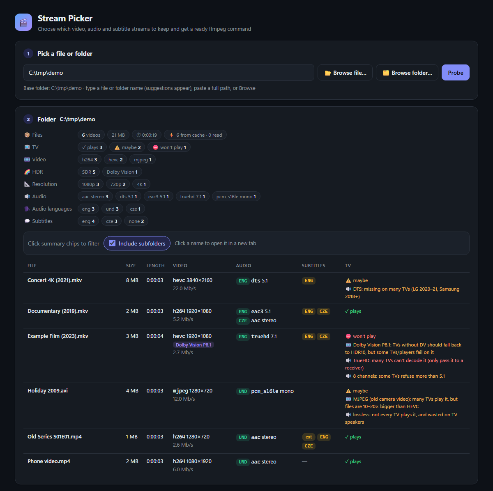
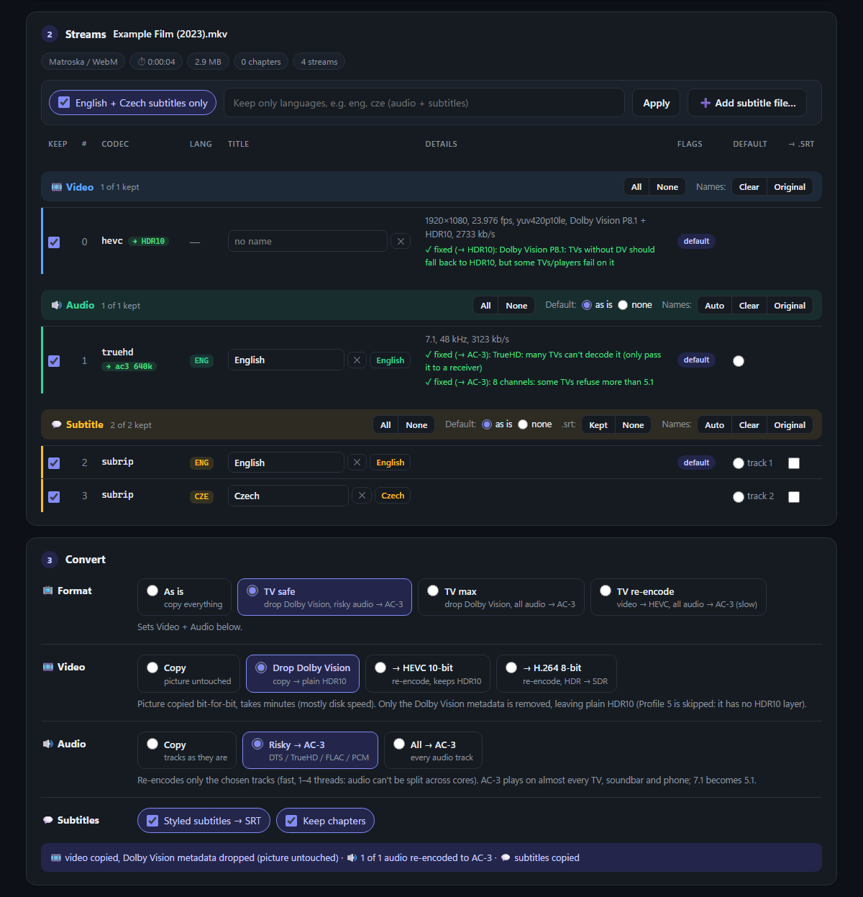
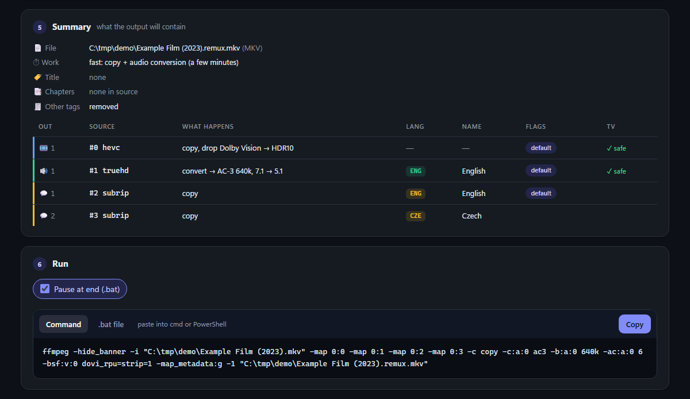

# Stream Picker

A small local web UI around **ffprobe / ffmpeg** for checking videos and getting them ready for a TV.
Pick a file or a whole folder, see what's inside and whether it will play, choose what to keep or convert,
and get a ready-to-run ffmpeg command or `.bat` file. Nothing is converted until you run it yourself.

- **Folder overview**: codecs, HDR, resolution, audio and subtitle languages, and a TV verdict
  (✓ plays / ⚠️ maybe / ⛔ won't play) for every video. Click the summary chips to filter.
- **Single file**: keep or drop tracks, set names, languages and default flags, add external subtitles,
  extract `.srt` files.
- **Converting for TVs**: drop Dolby Vision (→ HDR10) without re-encoding, audio → AC-3, re-encode to
  HEVC / H.264 on the CPU (x265 / x264) or an NVIDIA GPU (NVENC), downscale, repack MKV ↔ MP4.

## Run

Needs Windows, Python 3 and ffmpeg + ffprobe (on `PATH`, in `FFMPEG_DIR`, or next to the script).

```bat
start.bat                          :: base folder = the folder above this one
python stream_picker.py D:\Videos  :: or any base folder
```

The page opens at http://127.0.0.1:8765.

## Screenshots




